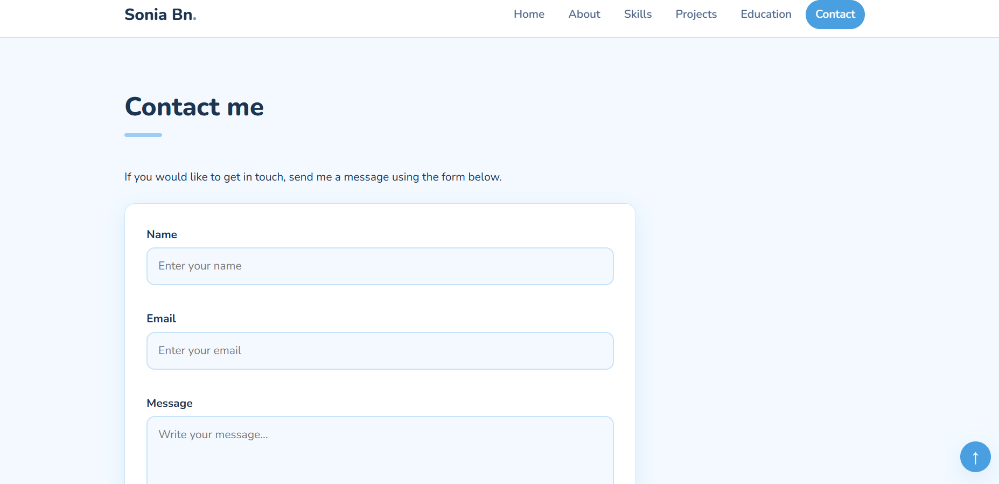
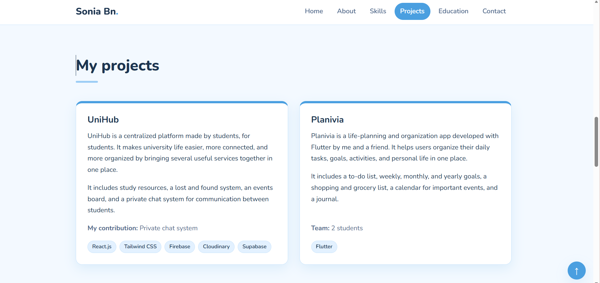
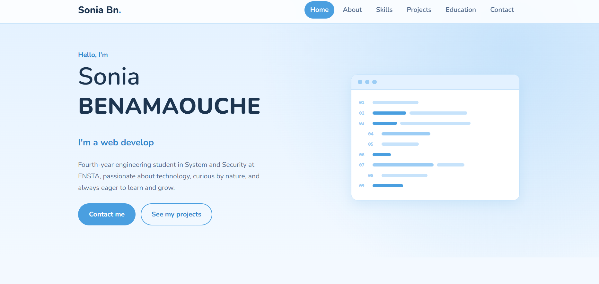

# Sonia Benamaouche - Personal Portfolio

**Student:** BENAMAOUCHE Sonia
**Module:** WAMD, TD/TP 1: Build a Responsive Portfolio Using HTML, CSS and JavaScript
**School:** Higher National School of Advanced Technologies (ENSTA), Algiers
**Semester:** First semester, 2026

## Project description

This is my personal portfolio website, built for the first WAMD lab. The goal was simple: a visitor should be able to quickly find out who I am, what I can do, what I have built, where I studied, and how to reach me.

I wanted it to feel clean and calm, so I went with a light sky-blue theme and the Nunito font. The site adapts to desktop, tablet and smartphone screens, and everything is written by hand with plain HTML, CSS and JavaScript (no frameworks or templates).

## Technologies used

- **HTML5**: semantic elements (`header`, `nav`, `main`, `section`, `article`, `footer`) and accessibility attributes (`aria-label`, `aria-expanded`, `aria-live`)
- **CSS3**: custom properties (design tokens), Flexbox, Grid, media queries, transitions and animations
- **JavaScript (vanilla)**: DOM manipulation, event handling, form validation
- **Google Fonts**: Nunito
- **Tools**: Visual Studio Code, Google Chrome / Firefox with DevTools, Git and GitHub

## Sections of the portfolio

| Section | What it shows |
|---|---|
| Home | Introduction, animated role text, and buttons to contact me or see my projects |
| About | A short presentation of who I am and what I am looking for |
| Skills | Web, programming, mobile, and cloud/tools, displayed as grouped chips |
| Projects | UniHub (React, Firebase) and Planivia (Flutter) with my role in each |
| Education | Timeline with ENSTA (System and Security) and my Baccalaureate |
| Contact | A validated contact form and my email address |

## Implemented features

- Fully responsive layout for desktop, tablet (max 900px) and smartphone (max 768px)
- Fixed header with a hamburger menu on small screens, which closes after clicking a link
- Active navigation link that updates automatically while scrolling
- Typing animation in the hero section that cycles through my roles
- Contact form with live validation (name, email format, message length) and a confirmation message
- Back-to-top button that appears after scrolling down
- Smooth scrolling between sections
- Footer year updated automatically with JavaScript
- Respect for `prefers-reduced-motion`: animations are turned off for users who ask for it
- Keyboard-friendly focus styles

## Project structure

```
My-Portfolio/
├── index.html
├── README.md
├── css/
│   └── style.css
├── js/
│   └── script.js
└── images/
    ├── Desktop1.png
    ├── Desktop2.png
    └── Desktop3.png
```

## Screenshots

Desktop view of the portfolio:







## Testing

I tested the site in Chrome and Firefox, and used the browser DevTools (device toolbar) to check the layout at desktop, tablet and smartphone sizes, as well as to debug the JavaScript through the console.

## How to run it

No installation is needed. Download or clone the repository, then open `index.html` in your browser.

```bash
git clone https://github.com/soniabena2005/My-Portfolio.git
cd My-Portfolio
```

## Notes

The contact form validates the input and shows a confirmation, but it does not send a real email, since the site has no backend. The message is only logged in the browser console. You can still reach me directly at the email address shown in the Contact section.

## Links

- **GitHub repository:** https://github.com/soniabena2005/My-Portfolio